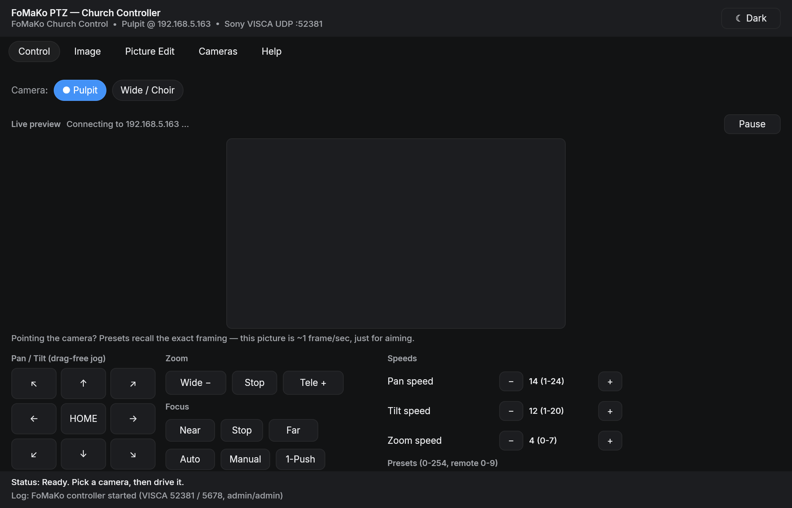
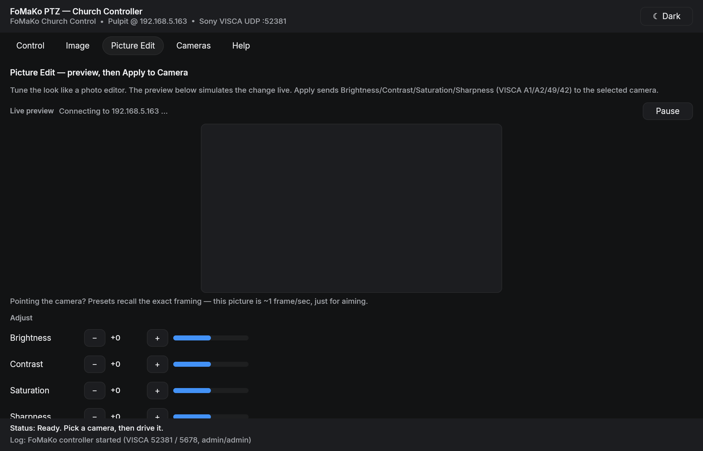

# FoMaKo Church PTZ Controller

Control your church's FoMaKo PTZ cameras from Windows / macOS / Linux — pan, tilt, zoom, focus, presets, full image settings, and a photo-style **Picture Edit** with live preview.

Built with **Rune** — a native GPU-rendered Rust UI (`github.com/anomalyco/rune`, `dev` rev `4a072bb06d1b410989f444caf0c9095b8596a565`).

Manual: [FoMaKo NDI/SDI/HDMI PTZ User Manual V3.0 (PDF)](https://fomako.net/uploads/20230817/fd1bfd181b89ae798bee1f7ed260a7b3.pdf)

 

## What it does

- **Control page**: PTZ pad (↖ ↑ ↗ ← HOME → ↙ ↓ ↘ + STOP), Zoom Tele/Wide + Stop, Focus Near/Far + Auto/Manual/1-Push, Pan/Tilt/Zoom speeds, Power ON/Standby, Presets 0–254 (quick 0–9 grid), multi-camera switcher, **live preview** (~1 frame/sec JPEG snapshots via ffmpeg, keyframe-only so the picture is never gray garbage).
- **Image page**: every FoMaKo setting from manual §5.2 — Exposure (Full Auto/Manual/Shutter/Iris/Bright), Shutter, Iris, Gain limit, Bright, ExpComp, Backlight, WDR, NR 2D/3D, Flicker, Gamma, Low-light, Aperture/Sharpness, Brightness, Contrast, Saturation (60–200%), WB + R/B Gain, Flip H/V, B/W, etc. Each row sends real VISCA.
- **Picture Edit**: photo-style Brightness / Contrast / Saturation / Sharpness sliders (-100…+100) with **live simulated preview** (color bars + gray ramp). **Apply to Camera** sends VISCA A1/A2/49/42. This is the “make the picture look like I want” feature.
- **Cameras page**: **auto-find** (subnet scan: TCP 5678 + UDP 52381 + HTTP sniff + ONVIF discovery, one-tap Add), add/remove, Select, Test (sends Stop + shows ACK), protocol toggle (Sony VISCA UDP :52381 recommended, or IP-VISCA TCP :5678), **per-camera login** (RTSP/web use it; VISCA needs none), saved to `fomako-cameras.json` beside the app (copy to every booth PC). Shows RTSP/RTMP/Web UI URLs for VLC/OBS/vMix.
- **Android (Native APK — recommended for Android)**: standalone Jetpack Compose app (`android/`) powered by the Rust VISCA & LAN discovery engine via JNI (`src/android_jni.rs`). Connects **directly** over WiFi to FoMaKo cameras (Sony VISCA UDP `:52381`, IP-VISCA TCP `:5678`, ONVIF + subnet scan, direct RTSP live preview) with **no PC or relay needed** (optional relay toggle included). Build with `scripts/build-android.sh` → `dist/fomako-church-controller-android.apk`.
- **Phones (iPhone / Android browser)**: open the web build in the phone browser (same WiFi). Because Android Chrome requires HTTPS for WebGPU on LAN IPs, pass `--https` to the LAN relay: `python3 scripts/visca-relay.py --port 8443 --https --serve-web dist/web`, then open the printed `https://<PC-LAN-IP>:8443/#relay=...&subnet=...&autostart=scan` URL (accept the self-signed cert prompt once; put the URL in a booth QR code). Rune has no native Android/iOS backend yet (`web → iOS → Android`), so the native Android app uses Jetpack Compose + Rust JNI while iOS uses the browser + relay path.
- **Help page**: 5-minute church setup (wire, lock IP/DHCP OFF, protocol, Sunday preset workflow, picture).

### Protocols (from manual p1-2)

- IP Visca port **5678** (TCP, raw `81 … FF`)
- Sony Visca port **52381** (UDP, `01 00 len seq + payload`)
- Onvif **2000**, user `admin` / `admin`, default IP `192.168.5.163`, LCD shows DHCP IP
- RTSP `rtsp://IP:554/live/av0` (main) / `av1` (sub), RTMP `rtmp://IP:1935/live/av0`, SRT `:9000`, NDI (NDI models)

### Live preview + camera passwords

The Control page shows a **live preview** (~1 frame/sec). It grabs JPEGs with `ffmpeg` (`rtsp://IP:554/live/av0`), so **ffmpeg must be installed** on the booth PC (`apt install ffmpeg` / `brew install ffmpeg` / `winget install ffmpeg`, or drop `ffmpeg(.exe)` next to the app). Frames are keyframe-only so the picture is never gray garbage; Pause stops fetching.

**Passwords:** VISCA control needs **no** password. The **video stream often does**: set each camera's login on the Cameras page (default `admin` / `admin` — change it there if the camera says 401). The preview then shows `retrying… 401 Unauthorized — check camera login` instead of failing silently. Passwords are stored in your local `fomako-cameras.json` only, never logged, and URL-encoded safely (`p@ss` can't break the RTSP URL). `FOMAKO_RTSP_PORT` env overrides port 554 for remapped/NVR setups.

Full streams still live in VLC/OBS (FoMaKo speaks RTSP/RTMP/SRT/NDI, manual §4.3).

## Run

```sh
cargo run
# headless check (no window, same renderer):
cargo run -- --snap shots/control.png --scene control
cargo run -- --snap shots/image.png --scene image
cargo run -- --snap shots/picture.png --scene picture
cargo run -- --snap shots/cameras.png --scene scan
# network tests (needs no camera; scan_live hits your real LAN):
cargo test
cargo test scan_live -- --ignored --nocapture
```

Scenes: `control image picture cameras help light scan`.

## Build (in this directory)

Status (v0.4.0):
- Linux x64: `dist/fomako-church-controller-linux-x64` + `.tar.gz` (app + static ffmpeg bundled — unzip and run, no install)
- Windows x64: `dist/fomako-church-controller-windows-x64.exe` + `.zip` (app + `ffmpeg.exe` bundled), cross-built here via `cargo zigbuild --target x86_64-pc-windows-gnu`
- Android: `dist/fomako-church-controller-android.apk` (standalone APK with Rust JNI VISCA/discovery core — direct WiFi control + RTSP preview, no PC needed)
- Web / phones: `dist/fomako-church-controller-web.zip` (UI + relay + setup sheet)
- Mac (Apple Silicon + Intel): `dist/fomako-church-controller-mac-arm64` / `-mac-x64` — both built from one `macos-15` runner in CI. Locally it needs a Mac (cross from Linux fails: no Apple `MacOSX.sdk` / `libobjc.tbd`); run `scripts/build-mac.sh` there. Binaries are unsigned, so right-click → Open the first time.

Prebuilt for everyone at [Releases](https://github.com/Jemo69/fomako-church-controller/releases) — current: **v0.4.0**.

`scripts/fetch-ffmpeg.sh [dest]` drops a static ffmpeg next to the app anywhere (used for the bundled zips). The app itself finds ffmpeg via `$FFMPEG_BIN`, `PATH`, its own folder, then per-OS install spots — see Help → "0. Live picture" for what it resolved to on your machine.

```sh
scripts/build-linux.sh    # dist/fomako-church-controller-linux-x64
scripts/build-windows.sh  # zig cross, no mingw needed
scripts/build-mac.sh      # run ON a Mac: dist/*-mac-*
scripts/build-android.sh  # dist/fomako-church-controller-android.apk
scripts/build-web.sh      # dist/web (phone + desktop browsers)
scripts/build-all.sh
```

Phone flow: on the LAN PC, `python3 scripts/visca-relay.py --port 8080 --serve-web dist/web`
(no pip packages needed), then open the printed URL + `#relay=...&subnet=...&autostart=scan`
on the phone. See `dist/web-release/PHONE_SETUP.txt`.

Linux needs: `libxkbcommon-dev libwayland-dev` (+ `libxkbcommon-x11-0 mesa-vulkan-drivers` to run).

Windows cross from Linux: `cargo install cargo-zigbuild` + `zig` (already used here) + `rustup target add x86_64-pc-windows-gnu`. Old mingw path also works.
Mac builds must run on a Mac (`rustup target add x86_64-apple-darwin aarch64-apple-darwin`), or via GitHub Actions (`macos-14`/`macos-15` runners).

Config file `fomako-cameras.json` is created next to the binary on first run.

### Every platform, portable

All five builds are portable: nothing is installed, no admin rights, no registry entries. Unzip to any folder — including a USB stick or external hard drive — and run it from there; `fomako-cameras.json` and the bundled ffmpeg travel with the folder, so the same drive works on any booth PC. Android is a plain sideloadable APK. If any platform behaves worse than the others on your machine (GPU rendering, preview, discovery), open an issue with the OS and GPU driver — parity across Linux / Windows / macOS / Android is the goal, and reports are what make it happen.

## Sunday workflow

1. Frame pulpit → Preset Sel `1` → **Set**. Choir → `2` → Set. Wide → `3` → Set.
2. During service tap **Recall 1/2/3** (or quick 0–9).
3. Keep Pan 10–16 / Tilt 10–14 for smooth moves. Preset 0 = power-on position if saved.

## Repo layout

- `src/main.rs` — Rune `AppSpec` + scenes
- `src/view.rs` — all UI (control/image/picture/cameras/help)
- `src/model.rs` — cameras, pages, image state, `fomako-cameras.json` persistence
- `src/actions.rs` — one-line VISCA send + log
- `src/visca.rs` — VISCA builders (§5.2) + Sony-UDP / TCP transport + tests
- `src/discover.rs` — LAN auto-find (subnet scan + ONVIF) + relay client + tests
- `src/preview.rs` — live preview (ffmpeg snapshots natively, relay snapshots on web)
- `scripts/` — linux/windows/mac/web builds + `visca-relay.py` (phone relay: scan, snapshot, static web UI)
- `shots/` — headless renders + boaz desktop captures (`preview-live.png`, `preview-drive.mp4`)
